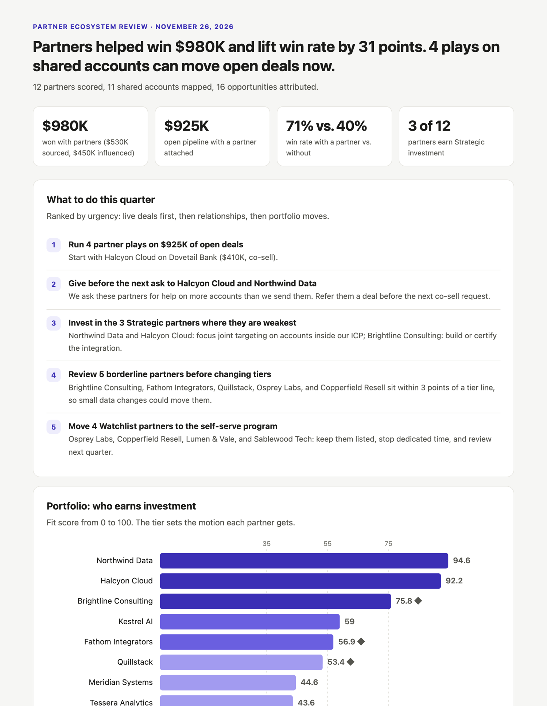
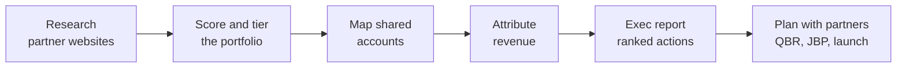

# AI Ecosystem Partnerships

[](https://github.com/varunk130/ai-ecosystem-partnerships/actions/workflows/ci.yml)
[](LICENSE)

**Run a partner ecosystem on evidence: research partners, decide where to invest, find the deals to work together, and prove what partners deliver. One command produces the exec report.**



## In one minute

| | |
|---|---|
| **Problem** | Most partner programs are run on anecdote. Every partner gets the same attention, shared customers go unnoticed, and nobody can say what partners actually delivered. |
| **Opportunity** | Software bought through cloud marketplaces grows to **$85B by 2028**, more than half of it through partners ([Canalys](https://canalys.com/newsroom/hyperscaler-cloud-marketplace)), and most B2B buyers involve a partner in the purchase ([Forrester](https://www.forrester.com/report/b2b-buyer-preferences-offer-an-undeniable-indicator-of-partner-ecosystem-importance/RES179588)). |
| **Solution** | AI skills and a tested toolkit that cover the full cycle: research a partner, score and tier the portfolio, map shared accounts, attribute revenue, and write a ranked action plan. |
| **Result (demo)** | **$980K** won with partners, a **71% vs. 40%** win rate with a partner attached, and **five ranked actions** for the quarter, from one command. |

## Executive summary

- **Why it matters.** Partners influence most B2B deals, but partner teams rarely have the data to show it or to decide where to spend their time.
- **What it does.** It answers the four questions every partner leader gets asked: who should we invest in, which deals should we work together, what did partners deliver, and what do we do next.
- **How it works.** Skills do the judgment work, such as researching a partner's website or drafting a joint business plan. The toolkit does the math, with transparent and tested scoring that anyone can audit.
- **What you get.** A one-page executive report that can be emailed or printed, plus skills that turn its findings into QBR briefs, joint business plans, and launch plans.

## How it works



## See it

Python 3.10 or newer; nothing to install.

```bash
git clone https://github.com/varunk130/ai-ecosystem-partnerships.git
cd ai-ecosystem-partnerships
python -m partner_ecosystem report        # writes report.html from the sample data
```

To use the skills with Claude Code, copy one into place, for example `cp -r skills/ecosystem-review ~/.claude/skills/`, and ask "run an ecosystem review".

## What's inside

| Stage | Skills |
|-------|--------|
| Research | [partner-research](skills/partner-research/SKILL.md) |
| Decide | [partner-fit-scorecard](skills/partner-fit-scorecard/SKILL.md), [product-partnership-evaluator](skills/product-partnership-evaluator/SKILL.md) |
| Execute | [co-sell-account-mapping](skills/co-sell-account-mapping/SKILL.md), [joint-business-plan](skills/joint-business-plan/SKILL.md), [integration-launch-plan](skills/integration-launch-plan/SKILL.md) |
| Review | [ecosystem-review](skills/ecosystem-review/SKILL.md) (end to end), [partner-qbr-brief](skills/partner-qbr-brief/SKILL.md) |

Also included: [playbooks](playbooks/README.md) on product partnerships, leading an ecosystem, and co-sell; the [usage guide](docs/HOW-TO-USE.md); and the [scoring method](docs/scoring-methodology.md).

---

Related: [ai-strategic-partnerships-skills](https://github.com/varunk130/ai-strategic-partnerships-skills) covers the deal side (thesis, structure, negotiation, term sheets). Contributing, security, and conduct policies are in [CONTRIBUTING.md](CONTRIBUTING.md), [SECURITY.md](SECURITY.md), and [CODE_OF_CONDUCT.md](CODE_OF_CONDUCT.md).

<sub>Built with Python (no dependencies) and Agent Skills for Claude Code and GitHub Copilot. All companies and figures in the sample data are fictional. MIT license.</sub>
